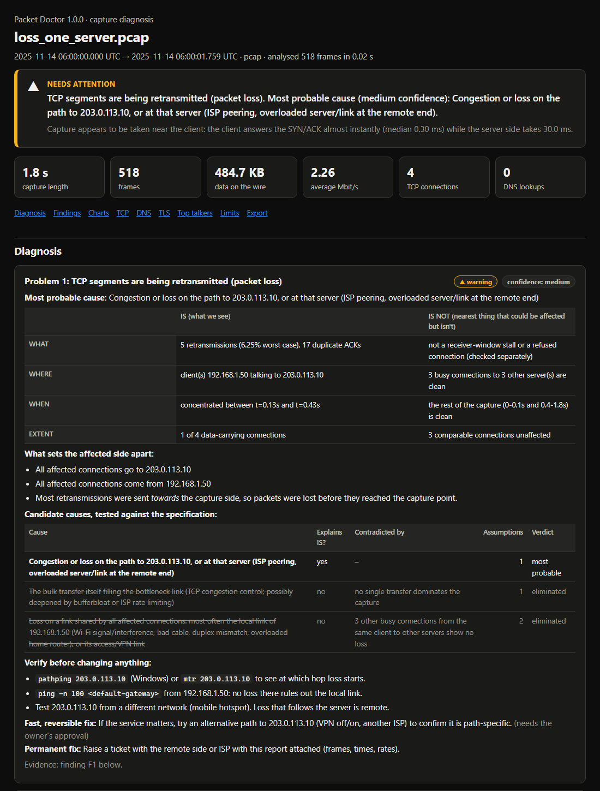
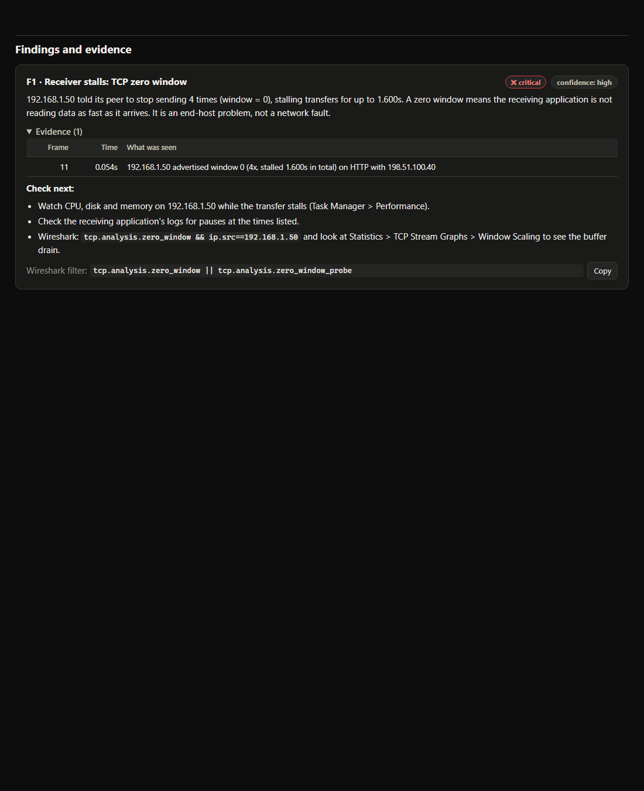
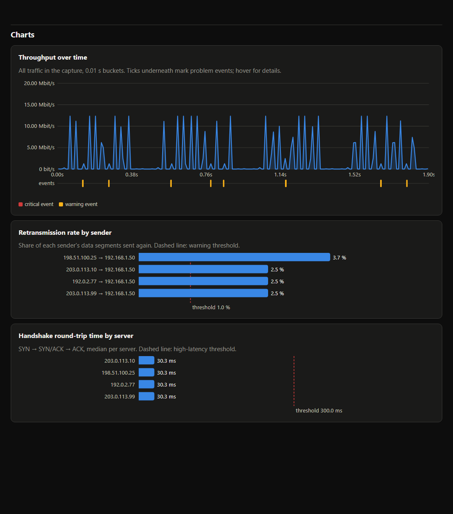
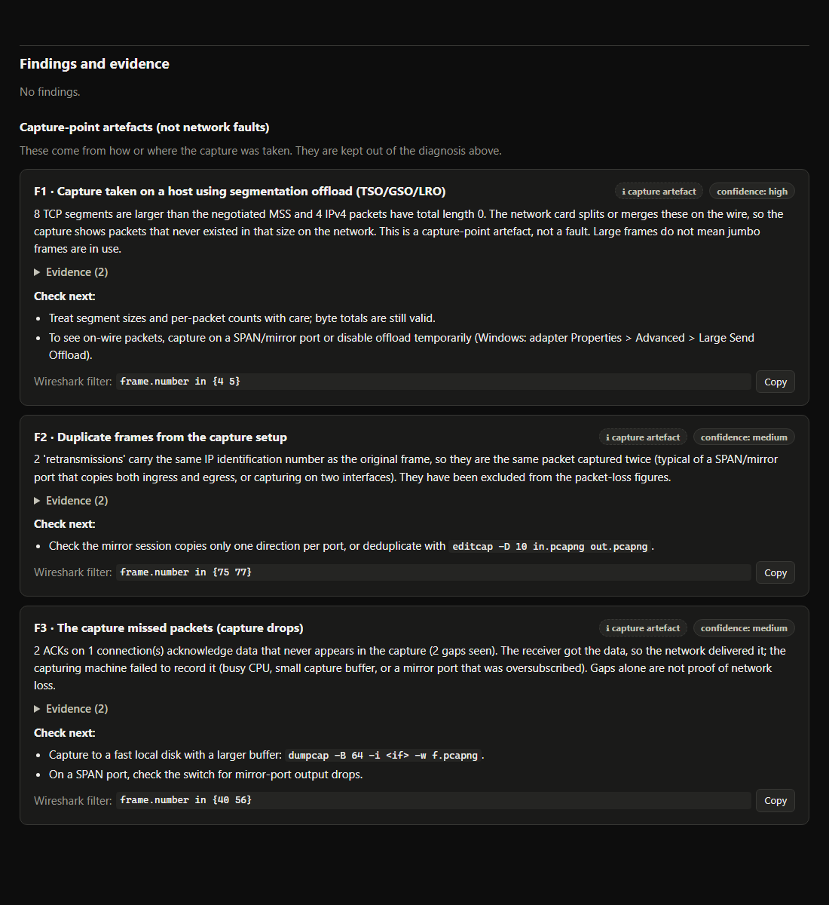

# Packet Doctor

**Give it a Wireshark capture. Get the diagnosis a senior network engineer would write, with the frame numbers to prove it.**

Packet Doctor reads `.pcap` / `.pcapng` files and explains, in plain English, what is wrong with the network and where: packet loss, receiver stalls, slow servers, failing DNS, rejected TLS handshakes. It also flags what is *not* a network fault (offload artefacts, capture drops, mirror-port duplicates). Each problem is written up with the **Kepner-Tregoe** method used in NOC troubleshooting: what IS affected, what IS NOT, which causes survive, how sure we are, and what to check next.

It runs entirely on your own computer, as a command-line tool or a local drag-and-drop page.



## Does it get the right answer?

The answers were checked against two references other than Packet Doctor itself:

| Check | Result |
|---|---|
| **Synthetic captures with injected faults** (13 files, known ground truth) | **169 / 169** injected events found, **0 missed, 0 false**; the expected cause was picked in all 7 scenarios that have one ([details](docs/validation.md)) |
| **Wireshark's own expert analysis** (tshark 4.6.2), frame by frame on every TCP flag | **100%** agreement on the synthetic corpus, on a real 30 s Wi-Fi capture (32,657 frames) and on a 326,570-frame stress file |
| **curl timings** taken during the real capture | The two slow servers Packet Doctor found (≈629 ms and ≈537 ms of server time) match curl's time to first byte |

The first real-capture run agreed with Wireshark on only 51% of flags. [validation.md](docs/validation.md) explains what was wrong and how reading Wireshark's source fixed it. Three independent code reviewers then tried to break the tool; every verified issue was fixed and has a regression test.

## Quick start (Windows)

You need Python 3.10+ (3.14 recommended) and Git. Wireshark is optional: it is only needed for the `judge` cross-check.

```bash
git clone https://github.com/<your-username>/packet-doctor.git
```

```bash
cd packet-doctor
```

```bash
py -3.14 -m venv .venv
```

```bash
.venv\Scripts\activate
```

```bash
pip install -e ".[dev]"
```

```bash
packet-doctor demo
```

`demo` analyses every capture in `samples/` and writes reports to `sample_reports/`. Open `sample_reports\loss_one_server.pcap.report.html` in a browser. (Ready-made copies are already in the repo, so you can look before installing anything.)

Analyse your own capture:

```bash
packet-doctor analyse path\to\capture.pcapng --open
```

Or start the local upload page (http://127.0.0.1:8765, reachable only from your PC):

```bash
packet-doctor serve
```

Run the tests and the Wireshark cross-check:

```bash
pytest -v
```

```bash
packet-doctor judge samples\*.pcap
```

On macOS or Linux use `python3 -m venv .venv` and `source .venv/bin/activate`; everything else is the same.

## What it checks

| Area | What is measured | Evidence given |
|---|---|---|
| TCP | Handshake RTT (split into client side and server side), retransmissions (plain, fast, spurious), duplicate ACKs, out-of-order, lost and ACKed-unseen segments, zero window (with stall duration), window full, resets, connection refused / no answer, server response time | Frame numbers, times, per-connection rates, a copyable Wireshark filter |
| DNS | Latency per lookup and per resolver (median, 95th percentile), NXDOMAIN (with benign cases recognised), SERVFAIL/REFUSED, timeouts, retries | Query frame, name, resolver, result |
| TLS | ClientHello → ServerHello time, full setup time (TLS 1.2 and 1.3), SNI, ALPN, negotiated version, handshake alerts | Frames, server name, alert meaning |
| Traffic | Throughput timeline, top talkers, top conversations, protocol mix, ICMP (incl. "fragmentation needed") | Charts and tables |
| Capture quality | Where the capture was taken, TSO/GSO offload, duplicate frames, capture drops, snaplen cuts, timestamps out of order, mid-stream connections | Kept separate from the diagnosis |

Each report also lists what was checked and found clean, and what the capture cannot tell you (encrypted payloads, QUIC, one capture point).





Capture artefacts are reported separately, never as network faults:



## Outputs

For a capture called `x.pcapng`:

* `x.pcapng.report.html`: one self-contained file (no internet needed), summary first, then the evidence and charts. Works in light and dark mode and prints cleanly.
* `x.pcapng.report.json`: everything, for scripts.
* `x.pcapng.findings.csv`, `x.pcapng.connections.csv`, `x.pcapng.dns.csv`: ready for Excel or Power BI.

Exit codes: 0 analysed, 1 critical problems found (only with `--fail-on-problems`), 2 file could not be read, 3 analysed but the file was damaged.

## Architecture

```
capture file ─► reader (streams one frame at a time; own pcap/pcapng readers, dpkt decodes packets)
                  │
     ┌────────────┼──────────────┬──────────────┐
     ▼            ▼              ▼              ▼
 TCP analyser  DNS analyser  Traffic stats  TLS analyser (fed by TCP reassembly)
 (Wireshark 4.6 rules)
     └────────────┴──────────────┴──────────────┘
                  ▼
          result (plain dict) ─► diagnosis (findings + Kepner-Tregoe records)
                  ▼
     HTML · JSON · CSV            judge (tshark comparison)      local web page (Flask)
```

| Module | Job |
|---|---|
| `reader.py` | Streaming pcap/pcapng readers (multi-interface pcapng, drop counters, cut-off detection); Ethernet, VLAN, raw IP, Linux cooked, loopback; IPv4 and IPv6 |
| `tcp.py` | Connection tracking and Wireshark-equivalent expert flags, RTT, zero-window time, request/response turns |
| `dns.py`, `tls.py`, `traffic.py` | Protocol and volume analysis |
| `diagnose.py` | Findings with evidence, confidence, IS / IS NOT, candidate causes, verification steps |
| `report.py`, `charts.py`, `templates/` | HTML (inline SVG charts), JSON, CSV |
| `judge.py` | Runs tshark on the same file and compares flags, stream numbers, RTT, DNS and SNI |
| `synth.py`, `scoring.py` | Synthetic fault captures with ground truth, and the detection table |

Why dpkt and not scapy or pyshark: [docs/design.md](docs/design.md).

Large files: the reader streams, so memory does not grow with the number of packets (a 326k-frame file peaked at 8 MB). It does grow with the number of TCP connections, at about 15 KB each. It runs at about 24,000 frames per second on a laptop. `--max-packets` and `--max-size-mb` are available, and the web page has an upload limit (200 MB by default).

## Employer summary

**What it shows:** I can take a raw packet capture and turn it into a defensible diagnosis, the core skill behind NOC, network-support and ISP operations roles.

* **Protocol depth:** a TCP analyser that matches Wireshark frame for frame, including SACK, windowing, retransmission classification and port reuse; DNS and TLS handshake analysis.
* **Structured troubleshooting:** Kepner-Tregoe Problem Analysis applied automatically: IS / IS NOT, cause elimination, verification before fixing, incident fix vs permanent fix.
* **Engineering judgement:** separates capture artefacts from real faults, states confidence and limitations, and didn't blame my Wi-Fi for loss that was really a speed test filling the link.
* **Validation discipline:** ground-truth test corpus, an independent reference (Wireshark), and honest reporting of where the first version was wrong.
* **Software practice:** Python packaging, pytest (61 tests, including regression tests from an independent code review), GitHub Actions CI on Linux and Windows, a hardened local Flask page, clear documentation.

**How a NOC would use it:** first-line triage of customer captures, consistent write-ups attached to escalation tickets, and fewer wrong escalations.

More: [interview talking points](docs/interview-talking-points.md) · [2-minute demo script](docs/demo-video-script.md) · [validation report](docs/validation.md) · [design notes](docs/design.md)

## Privacy

Captures can contain private information (IP addresses, hostnames, sometimes passwords in unencrypted protocols). Packet Doctor never sends data anywhere. The upload page listens only on 127.0.0.1, refuses requests from other websites (Host/Origin checks and a CSRF token), and deletes each upload after analysis. `private_captures/` is git-ignored: keep your own captures there. Only analyse traffic you are allowed to capture.

## Licence

MIT. See [LICENSE](LICENSE). The synthetic sample captures in `samples/` were generated by this project and are covered by the same licence. Public Wireshark sample captures are *not* included; `scripts/fetch_public_samples.py` downloads a few on request for extra testing.
